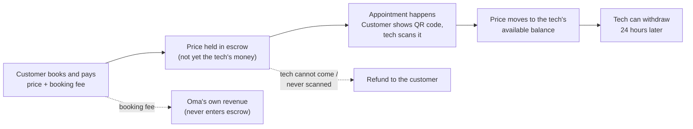
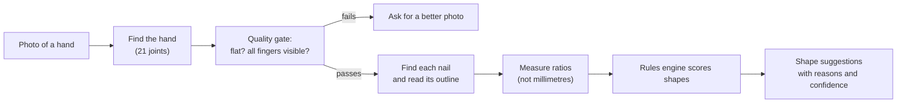
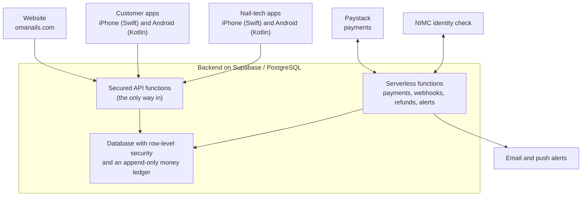

# Oma — find a nail tech near you, and pay safely

**Live at [omanails.com](https://omanails.com)** · iPhone and Android apps for customers and nail techs · Built in Nigeria by OMA NAILS LTD

> **About this repository.** This repo is documentation only. It explains what Oma is and how it works. The source code is private and is not included here.

---

## At a glance

| | |
|---|---|
| **Problem** | Nail techs in Nigeria are found through Instagram DMs and word of mouth. Customers cannot tell who is real or who will turn up, and have to pay a stranger up front. Techs lose income to no-shows and have no safe way to be paid. |
| **Solution** | A marketplace where customers find a nail tech nearby, book a time, and pay into **escrow**. The tech is paid only when she scans the customer's QR code at the appointment. |
| **Extra** | A hand scan that suggests which nail shapes suit a customer, then connects her to techs who do that shape. |
| **Who it is for** | Customers who want a nail tech they can trust, and nail techs (shops, home-service techs and salons) who want bookings and reliable payment. |
| **Status** | Live. The website and the iPhone and Android apps are out, and we are onboarding our first nail techs. |
| **Built with** | Swift (iPhone), Kotlin (Android), HTML/CSS/JavaScript (web), PostgreSQL on Supabase, Paystack for payments. |

---

## The problem

Booking a nail tech in Nigeria usually means scrolling Instagram, sending a DM, agreeing a price on WhatsApp and transferring money to someone you have never met. That creates problems for both sides.

- A customer cannot tell whether a tech is who she says she is. She pays first and hopes.
- A tech who is stood up loses the slot and the money. A tech who does great work has nowhere to build a verifiable track record.
- Neither side has anywhere to go when something goes wrong.
- A customer picking a style has no idea which shapes suit her own hands, so she copies a photo and hopes it works.

## What Oma does

Oma puts the whole journey in one place: **discover, book, pay safely, show up, get paid, review**. The central idea is that **the customer's money is held by Oma, not given to the tech up front, and only moves to the tech when the appointment actually happens.** The QR scan is the proof that it did.

---

## How it works

### For a customer

1. **Find.** Open the app and see nail techs on a map and in a list, nearest first. Search by name, area, service or nail shape.
2. **Look.** Each tech has a page with her services and prices, photos of her work, her working hours and her reviews. Techs who have verified their identity carry a pink "NIN verified" badge.
3. **Book.** Pick a service and a time. You can only choose times inside the tech's working hours. Choose her place or, if she travels, your home.
4. **Pay.** Pay the price of the service plus a small booking fee. The slot is held for 30 minutes while you pay. The money goes into escrow.
5. **Go.** Your booking has a QR code. The exact address and directions unlock shortly before the appointment (Apple Maps or Google Maps, your choice). You can chat with the tech about the booking.
6. **Scan.** At the end of the appointment you show your QR code. The tech scans it, and only then is she paid.
7. **Review.** Only customers with a completed (scanned) appointment can leave a review, so reviews come from real clients.

### For a nail tech

1. **Create a listing.** Add a shop or choose "I don't have a shop" if you travel to clients. Add services, prices, photos and working hours.
2. **Go live.** Switch the listing on and clients nearby can book you. Techs without a shop appear on the map during their working hours and stop when the day ends.
3. **Verify to travel.** Techs can verify their identity with a check against NIMC (Nigeria's National Identity Management Commission). Only verified techs can offer home visits. Verified techs show a badge.
4. **Set your own home-visit price** per service. You choose whether you travel at all.
5. **Get paid.** When the client's QR code is scanned, the money moves from "held" to your available balance. You can withdraw it to your bank account 24 hours after the scan.
6. **If the client doesn't show,** you can mark a no-show from 30 minutes after the start. If nothing shows the client was there, you are paid.

### Where the money goes

Oma earns in two ways. The customer pays a small flat **booking fee** per booking, which goes straight to Oma and is never part of the escrow. The tech pays a small **service fee** only when an appointment is completed: a flat amount per service, plus a small percentage on the part of a sale above a threshold. Nothing is charged on a booking that is refunded or expires. The tech also bears the card-processing fee on her own sale.

### Trust and safety

- **Identity.** Techs can verify against NIMC. Oma never stores the ID number. It keeps only whether the check passed, whether the name matched, and a one-way fingerprint. Home visits are gated by identity verification.
- **Reports.** After the appointment time has passed, either side can report a problem (safety, harassment, theft, no-show or other) and attach a video. Reports about safety, harassment or theft are reviewed by a person and are never closed automatically.
- **Only Oma can hold or refund a payment.** Customers cannot freeze a tech's payment on their own, and refunds go through Oma staff to the customer's saved refund account. This protects techs from false claims and customers from a tech who disappears.
- **Location privacy.** During an appointment the app can check how far the person is from the place. It stores the distance and the time, not their position, and deletes that after 30 days. A home address is shown to the tech as an area first and as a street only once payment is held.
- **Chats** are visible only to the customer and the tech during the booking. Oma keeps a copy for safety reviews.

### The nail-shape scan

Customers can open the **Scan** tab, photograph their hand, and get a recommendation for which nail shapes suit them. The result is carried into the booking and can jump straight to techs who do that shape.

A few choices make it honest and safe to ship:

- **It runs on the phone.** The hand photo is analysed on the device. We treat hand geometry as sensitive, so keeping the photo on the device is a design rule.
- **Ratios, not millimetres.** A phone camera does not know real size, so every rule is a ratio, for example nail-bed length to width. The same hand at a different distance gives the same answer.
- **A rules engine, not a black box.** Nail-shape advice is stylist convention. Encoding it as versioned, readable rules means the app can say *why* it suggests a shape, and the rules can be tuned without an app update.
- **It says when it is unsure.** Each result carries a confidence score. When confidence is low it falls back to the safe, flattering default instead of bluffing, and a photo that fails the quality gate is rejected rather than measured badly.

---

## Features

| For customers | For nail techs | Behind the scenes |
|---|---|---|
| Map and list of techs, nearest first | Shop or "no shop" mobile listing | Escrow ledger with append-only records |
| Search by name, area, service or shape | Services, prices, photos, working hours | QR-code release of funds |
| Escrow payment with a QR code on the ticket | Optional home visits at her own prices | Staff console with separate departments (support, safety, HR) |
| In-app chat with the tech | Wallet, balance and bank withdrawals | Automatic refunds and an owner-only refund desk |
| Reviews from completed appointments only | Identity verification and badge | Push alerts and an internal alert system |
| Loyalty points and referral rewards (O points) | Alerts for new bookings | Automated tests on the money and API layers |
| Nail-shape scan | Scans the customer's QR code to get paid | Owner dashboard with a live globe and a map of the whole system |

---

## Architecture

The same backend serves the website and all four apps, so a booking made on the web shows up in the app and the other way round. The website sits behind Cloudflare, and builds and tests run through automated pipelines.

### Design decisions worth knowing

- **Money is whole numbers and a ledger.** Amounts are stored as integers (kobo), never decimals. Balances are always computed from an append-only ledger, so there is no "balance" number that can be edited.
- **Every money step locks first.** Payment webhooks retry and people double-tap. Each money change takes a lock on the booking so a second attempt sees the first and nothing is paid twice.
- **The database is the wall.** Row-level security means a phone can only ever read its own rows. The apps can call only a small set of named API functions. Internal money functions are not reachable from a phone at all.
- **The QR code is derived, not stored.** It is a signed value computed from the booking, so a customer can reopen her ticket on a new phone and get the same code, while a leaked database holds nothing redeemable.
- **Sensitive data is not kept.** The ID number is never stored, and the hand photo does not leave the phone.
- **Tested like a bank, not a website.** The money core and the API are attacked by automated test suites running on a real database. They cover refunds, duplicate webhooks, forged requests, and one customer trying to read another's ticket.

---

## Where Oma stands, honestly

**Working today**
- Booking, escrow payments, QR release, wallet and withdrawal requests, refunds, reviews, chat, notifications and the staff console are all built and in use.
- Customer and tech apps are on iPhone and Android, and the website works on any phone.
- Identity verification against NIMC, optional home visits and mobile techs on the map are live.

**Early or in progress**
- **The nail-shape scan is an early feature.** The pipeline works and is tested, but its thresholds are still being calibrated against real hands and professional nail techs, and accuracy on everyday photos is not proven yet. Skin-undertone and colour advice is not ready, and we have not shipped it.
- **Payouts and refunds are reviewed and sent by Oma staff** while we wait for direct bank-API access to automate them.
- **We are onboarding our first nail techs.** Supply is the main thing we are working on.

**Next**
- Salon business accounts, where an owner can manage several techs, see earnings per tech and be paid at the business account.
- Automated bank payouts and refunds.
- Calibrating and validating the scan with working nail techs, then adding colour guidance.
- Wider availability across Nigeria and beyond.

---

## Try it and get in touch

- **Website:** [omanails.com](https://omanails.com)
- **Apps:** search for **Oma** in the App Store or Google Play (a customer app and a separate nail-tech app), or start at omanails.com.
- **Email:** hello@omanails.com
- **Company:** OMA NAILS LTD, a registered Nigerian company.
- **Founder:** Kamsy, Founder and CEO.

*This repository describes the product for the hackathon. It contains no source code, keys or user data.*
